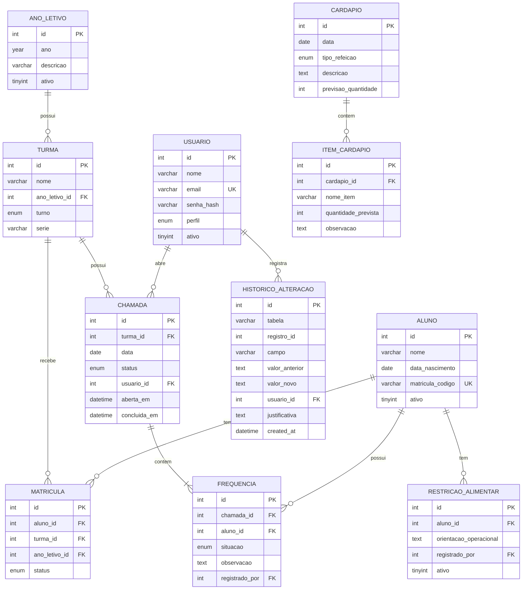

# 3. Dicionário de Dados e Diagrama Entidade-Relacionamento (DER)
**Papel Técnico:** Analista de Dados  
**Projeto:** Central de Frequência e Alimentação Escolar (Grupo 01)  
**Evento:** Mostra de Tecnologia 2026  

---

## 1. Diagrama Entidade-Relacionamento (Mermaid)

---

## 2. Dicionário de Dados das Tabelas Principais

### Tabela `chamada`
- **id** (INT UNSIGNED, PK, Auto Increment): Identificador único da chamada.
- **turma_id** (INT UNSIGNED, FK turma.id): Turma da chamada.
- **data** (DATE): Data da chamada escolar.
- **status** (ENUM 'aberta', 'concluida'): Situação operacional da chamada.
- **usuario_id** (INT UNSIGNED, FK usuario.id): Inspetor que abriu a chamada.
- **aberta_em** (DATETIME): Timestamp de abertura.
- **concluida_em** (DATETIME, Nullable): Timestamp de fechamento.
- **Restrição de Integridade:** `UNIQUE KEY uk_chamada_turma_data (turma_id, data)` garante que nenhuma turma tenha duas chamadas no mesmo dia.

### Tabela `frequencia`
- **id** (INT UNSIGNED, PK, Auto Increment): Identificador do registro.
- **chamada_id** (INT UNSIGNED, FK chamada.id, ON DELETE CASCADE): Chamada correspondente.
- **aluno_id** (INT UNSIGNED, FK aluno.id): Aluno avaliado.
- **situacao** (ENUM 'presente', 'ausente', 'justificado'): Estado de presença.
- **observacao** (TEXT, Nullable): Motivo informado ou atestado.
- **registrado_por** (INT UNSIGNED, FK usuario.id): Inspetor ou gestor que marcou.
- **Restrição de Integridade:** `UNIQUE KEY uk_frequencia_chamada_aluno (chamada_id, aluno_id)` garante exatamente um status por aluno em cada chamada.

### Tabela `restricao_alimentar`
- **id** (INT UNSIGNED, PK, Auto Increment): Identificador.
- **aluno_id** (INT UNSIGNED, FK aluno.id): Aluno associado.
- **orientacao_operacional** (TEXT): Orientações estritamente práticas de preparo de alimentos (ex: "Sem glúten", "Sem lactose"). Sem dados clínicos/diagnósticos.
- **registrado_por** (INT UNSIGNED, FK usuario.id): Operador que cadastrou.
- **ativo** (TINYINT): 1 ativo, 0 inativo.

### Tabela `historico_alteracao`
- **id** (INT UNSIGNED, PK, Auto Increment): Identificador do log.
- **tabela** (VARCHAR(100)): Nome da tabela modificada.
- **registro_id** (INT UNSIGNED): ID do registro modificado.
- **campo** (VARCHAR(100)): Coluna alterada (ex: `situacao`).
- **valor_anterior** (TEXT, Nullable): Valor original antes da edição.
- **valor_novo** (TEXT, Nullable): Novo valor gravado.
- **usuario_id** (INT UNSIGNED, FK usuario.id): Autor da modificação.
- **justificativa** (TEXT, NOT NULL): Motivo formal obrigatório da correção.
- **created_at** (DATETIME): Data e hora exatas da operação.
